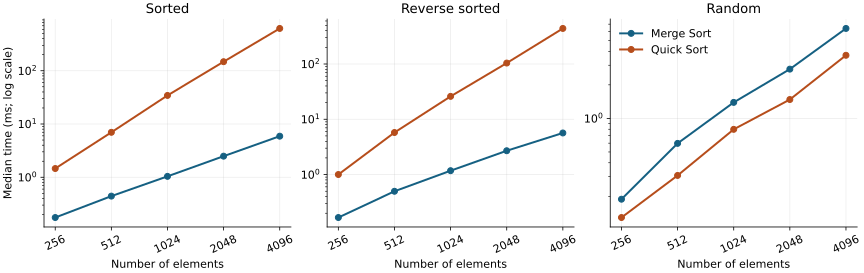
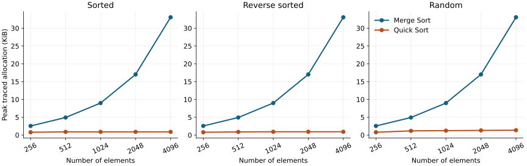

# Assignment 2: Analyzing and Implementing Divide-and-Conquer Algorithms

This folder contains Merge Sort and Quick Sort implementations, correctness
tests, and measured performance on sorted, reverse-sorted, and random data.
The written analysis is submitted separately through the course portal.

## Run the code

Python 3.10 or newer is required. Sorting, testing, and benchmarking use only the
standard library. From the repository root:

```bash
cd assignment2
python sorting.py
python -m unittest -v
python benchmark.py
```

The benchmark overwrites the files in `results/`. To preserve the included run:

```bash
python benchmark.py --output results_local
```

Optional chart regeneration reads `results/summary.csv`:

```bash
python -m pip install matplotlib
python plot_results.py
```

## Algorithms and complexity

Both functions sort ascending, mutate the supplied list, and return that same
list. Values must have a consistent `<=` ordering. The analysis assumes
constant-time element comparisons and counts auxiliary space separately from
the input list.

Merge Sort divides a half-open range into two halves, recursively sorts each,
and merges them through one reusable buffer. Choosing the left value on a tie
makes it stable. The implementation always merges, even if the input is sorted.
Quick Sort uses Lomuto partitioning and the last element as its pivot. It is
not stable. The fixed pivot deliberately exposes its sensitivity to input order.

| Algorithm and case | Upper bound O | Lower bound Ω | Tight bound Θ | Auxiliary space |
| --- | --- | --- | --- | --- |
| Merge Sort, best/average/worst | n log n | n log n | n log n | Θ(n) buffer plus O(log n) stack |
| Quick Sort, best | n log n | n log n | n log n | O(log n) stack |
| Quick Sort, average over uniform distinct-key permutations | n log n | n log n | n log n | O(log n) stack |
| Quick Sort, worst | n² | n² | n² | O(log n) stack bound; O(1) on monotone/all-equal input |

The Quick Sort space bound is specific to this implementation: it recursively
sorts only the smaller partition and uses a loop for the larger partition.
Every recursive child has at most half the current elements. Its *work* still
follows the usual two-subproblem recurrence, even when one branch is implemented
as a loop. This prevents a deep call stack but does not prevent quadratic work.

## Recurrence solutions

Write lg for log base 2; base cases of size zero or one cost Θ(1). Rounding
subproblem sizes does not change the following asymptotic bounds.

### Merge Sort

For powers of two, T(n) = 2T(n/2) + g(n), where c₁n ≤ g(n) ≤ c₂n for
positive constants c₁ and c₂. For other sizes, use floor(n/2) and ceil(n/2).

* **Substitution.** For the upper bound, assume T(n/2) ≤ A(n/2)lg(n/2) + B(n/2).
  Then T(n) ≤ An lg n + Bn + (c₂ − A)n ≤ An lg n + Bn when A ≥ c₂.
  Choose B to cover the base case. Reversing the inequalities with a ≤ c₁
  and an appropriate linear base term proves Ω(n lg n). Together these give Θ(n lg n).
* **Recursion tree.** Level j has 2ʲ subproblems of size n/2ʲ. Its nonrecursive
  work lies between c₁n and c₂n. There are lg n internal levels and n leaves,
  so the total is Θ(n lg n) + Θ(n) = Θ(n lg n).
* **Master method.** a = 2, b = 2, and f(n) = Θ(n) = Θ(n^(log_b a)).
  Case 2 gives Θ(n lg n).

### Quick Sort

Partitioning n elements performs n − 1 key comparisons, giving
T(n) = T(k) + T(n − k − 1) + Θ(n), where k is the final pivot rank.

* **Balanced best case.** For n = 2ʰ − 1, both children have (n − 1)/2
  elements. Substituting m = n + 1 turns the recurrence into
  S(m) = 2S(m/2) + Θ(m). The preceding substitution proof and Master case 2
  give Θ(n lg n). In the recursion tree, the first half of the Θ(lg n)
  levels each do Θ(n) work, proving the matching lower bound; each level is
  O(n), proving the upper bound.
* **Worst case.** Sorted, reverse-sorted, and all-equal inputs repeatedly give
  a side of size n − 1. The recursion tree is a chain with partition costs
  n − 1, n − 2, …, 1. Thus the exact comparison count is
  W(n) = n(n − 1)/2. Substitution verifies this: if W(n − 1) = (n − 1)(n − 2)/2,
  then W(n) = W(n − 1) + n − 1 = n(n − 1)/2, with W(1) = 0.
  Total time is Θ(n²). The standard Master theorem does not apply to n − 1.
* **Average case.** For a uniformly random permutation of distinct keys, each
  pivot rank is equally likely. The expected comparisons satisfy
  Cₙ = (n − 1) + (2/n)Σₖ₌₀ⁿ⁻¹Cₖ, with C₀ = C₁ = 0.
  Subtracting the equation for n − 1 from the one for n after multiplying
  by their sizes gives nCₙ = (n + 1)Cₙ₋₁ + 2(n − 1).
  Divide by n(n + 1) and telescope to obtain
  Cₙ = 2(n + 1)Hₙ − 4n, where Hₙ = Σⱼ₌₁ⁿ1/j = Θ(log n).
  Hence expected time is Θ(n log n). An expected recursion-tree argument
  counts a pair of ranks i < j when one endpoint is the first pivot among
  ranks i through j; this has probability 2/(j − i + 1). Summing over all
  pairs yields the same expression. Standard Master case 2 cannot be applied
  directly to this average recurrence because its subproblem sizes vary.

## Measurement method

The included run uses n = 256, 512, 1024, 2048, and 4096, with distinct integers
0 through n − 1. Random input is a reproducible permutation made with
`random.Random(532 + n).shuffle`. Both algorithms receive identical input
values and fresh list copies. One warmup precedes seven timing trials, and
algorithm order alternates between trials. `perf_counter_ns` measures only
the sort. Input generation, copying, garbage collection, and correctness
checks are outside the timer; cyclic garbage collection is disabled while
timing. Every result is checked against the expected ascending sequence.

Memory is measured in three **separate** runs using `tracemalloc`, so tracing
overhead cannot inflate the reported timings. The median of each run's peak
is reported. Input copies are allocated before tracing begins. This measures
new Python-traced auxiliary allocations, including the Merge Sort buffer;
it is not total process memory (RSS) or a complete measurement of native
stack space. KiB means 1,024 bytes.

`results/raw.csv` retains all 300 measurements. `results/summary.csv` contains
30 summaries, including median, minimum, and maximum times.
`results/environment.json` records the runtime, seed, settings, and SHA-256
hashes of the measured source files. This run is an observation on one Linux
environment, not a universal ranking. Repeated timings use one random
permutation per size, so they measure runtime variability rather than the
distribution across random permutations.





## Interpreting the comparison

At 4,096 elements, median times were 5.91, 5.65, and 6.41 ms for Merge Sort
on sorted, reverse-sorted, and random input, respectively. Quick Sort took
622.83, 439.47, and 3.68 ms. Merge Sort's peak traced allocation was 33.06 KiB
in all three cases; Quick Sort used 0.90, 0.93, and 1.37 KiB, respectively.
Doubling sorted input from 2,048 to 4,096 multiplied Quick Sort time by 4.21
and Merge Sort time by 2.37. The exact unrounded results are in the CSV files.

Merge Sort keeps its Θ(n log n) growth across input orders, but its buffer and
copy-back operations consume memory and time. Quick Sort can be competitive
on randomly ordered input while using less auxiliary memory. Its quadratic
behavior on monotone inputs comes from the fixed last-element pivot. The
smaller-side recursion optimization controls stack space without repairing
those unbalanced partitions. Sorted and reverse-sorted timings can also differ
despite identical comparison counts because they execute different numbers of
swaps and take different branches.

For stable reporting or predictable runtime, Merge Sort is a reasonable
choice when its buffer fits in memory. Production Quick Sort can use random
pivots or median sampling, three-way partitioning for duplicates, and an
introspective fallback for worst-case protection. These improvements are not
implemented here. For datasets larger than RAM, external merging of sorted
runs makes sequential disk access possible, but I/O must be measured separately.
Cache behavior, interpreter overhead, and allocation costs are plausible
contributors to timing differences; this benchmark does not measure cache
misses and therefore cannot attribute a particular difference to them.

## References

Cormen, T. H., Leiserson, C. E., Rivest, R. L., & Stein, C. (2022).
*Introduction to algorithms* (4th ed.). MIT Press.

Python Software Foundation. (n.d.-a). *time — Time access and conversions*.
Python 3 documentation. https://docs.python.org/3/library/time.html

Python Software Foundation. (n.d.-b). *tracemalloc — Trace memory allocations*.
Python 3 documentation. https://docs.python.org/3/library/tracemalloc.html

Sedgewick, R., & Wayne, K. (n.d.-a). *2.2 Mergesort*. Algorithms, 4th edition.
https://algs4.cs.princeton.edu/22mergesort/

Sedgewick, R., & Wayne, K. (n.d.-b). *2.3 Quicksort*. Algorithms, 4th edition.
https://algs4.cs.princeton.edu/23quicksort/
